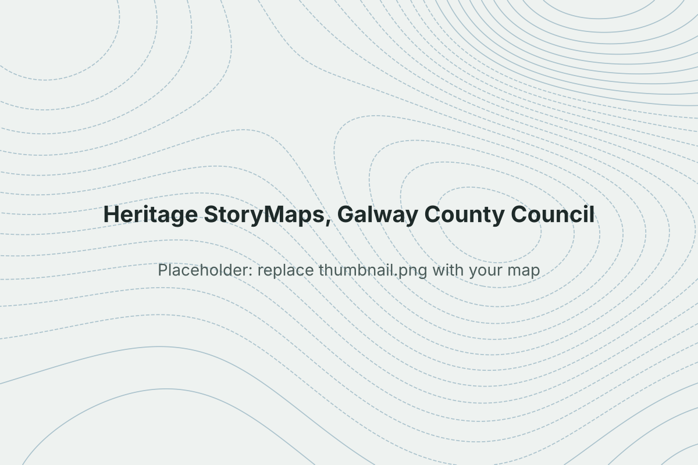

```{=html}
<dl class="project-facts">
  <dt>Role</dt><dd>GIS Intern, Galway County Council</dd>
  <dt>Tools</dt><dd>ArcGIS Online, ArcGIS StoryMaps</dd>
  <dt>Audience</dt><dd>Local heritage groups and the public</dd>
</dl>
```

## Problem

Heritage groups hold detailed local knowledge but rarely have a way to share it as an interactive map. The brief was to turn their material into StoryMaps the public could explore.

## Method

- Gathered sites, photos and text from each heritage group
- Built the web maps and point layers in ArcGIS Online
- Designed the StoryMaps for a non-technical public audience
- Presented the finished work to council members, including the Cathaoirleach

## Result

{fig-alt="Screenshot of a heritage StoryMap"}

::: {.todo}
**Add:** a screenshot of the best StoryMap, and links to the live StoryMaps if they're public.
:::

## What this shows

Taking local knowledge from non-specialists, turning it into clear public maps, and presenting the result to elected representatives.
