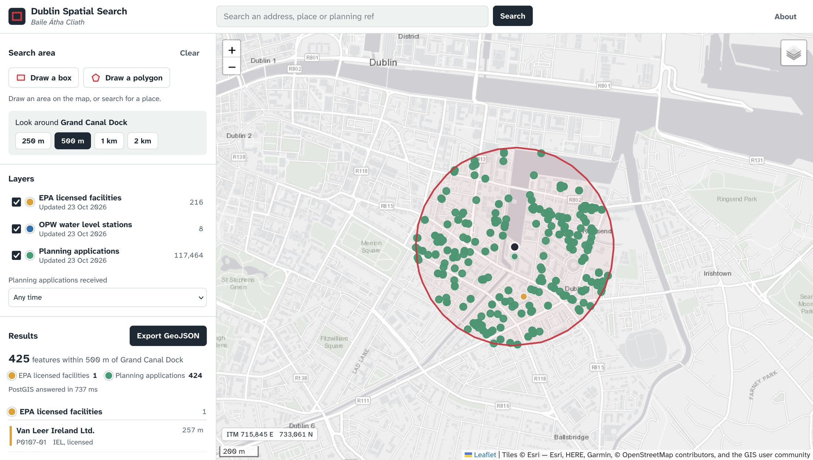

```{=html}
<dl class="project-facts">
  <dt>Question</dt><dd>What's inside any part of Dublin, across three agencies' data, in one search?</dd>
  <dt>Tools</dt><dd>Python (Flask, psycopg), PostgreSQL + PostGIS, SQL, JavaScript (Leaflet), Docker</dd>
  <dt>Data</dt><dd>EPA licensed facilities; OPW hydrometric stations; National Planning Application Database (all CC BY 4.0)</dd>
  <dt>CRS</dt><dd>WGS 84 (EPSG:4326) for storage; Irish Transverse Mercator (EPSG:2157) for distances</dd>
</dl>
```

## Live app

Draw a box or polygon on the map, or search an address and pick a radius. Click any result for its details, or export the search as GeoJSON.

```{=html}
<div class="hero-actions">
  <a class="btn-map primary" href="https://dublin-spatial-search.onrender.com/" target="_blank" rel="noopener">Open the app</a>
</div>
<p class="live-map-link">It runs on free hosting, so the first search can take up to a minute while the server wakes up.</p>
```

{fig-alt="Web map of Dublin's Docklands with a red 500 m search circle full of planning application points, beside a sidebar of layers and results"}

## Problem

Environmental and planning data for Dublin is spread across separate viewers. The EPA, the OPW and each of the four councils publish their own. Checking what's around one site, for example when screening a development for an environmental assessment, means visiting each viewer in turn and combining the results by hand.

## Data

- 216 EPA licensed facilities (industrial emissions, IPC and waste licences) from the EPA's GeoServer web feature service
- 8 OPW water level stations with their latest reading, from waterlevel.ie
- 117,464 planning applications from Dublin City, Fingal, South Dublin and Dún Laoghaire-Rathdown councils, from the National Planning Application Database's ArcGIS REST service

## Method

- Wrote a Python loader that downloads each source, keeps the Dublin records and drops bad coordinates. Planning applications are paged from ArcGIS 2,000 at a time, and applicant names are never downloaded
- Loaded all three layers into one PostGIS table, with a GIST spatial index on the geometry and trigram indexes for searching names and planning references
- Built a Flask API that sends the drawn shape to PostGIS and finds features with `ST_Intersects`
- Buffered radius searches in Irish Transverse Mercator, so the radius and the distances are in true metres
- Had PostGIS build the GeoJSON response itself (`json_agg`), so the API passes it straight to the map
- Reloaded each layer inside one database transaction, so the live app never shows a half-loaded layer
- Built the front end in Leaflet, with drawing tools, an address search (OpenStreetMap Nominatim), layer and date filters, GeoJSON export and a live ITM coordinate readout
- Deployed the database on Neon and the app on Render, both from Docker

## Result

- **117,688 features** are searchable in one query: 117,464 planning applications, 216 licensed facilities and 8 river gauges.
- **A 500 m search around Grand Canal Dock** returns 425 features in 0.7 seconds: 424 planning applications and one licensed facility, 257 m away.
- **Any search exports as GeoJSON** with source and licence details, ready to open in QGIS.
- **Use cases** include environmental assessment site screening, the planning history of a site, and checking a street before buying a house.

## Limitations

- Planning records reach the national database from each council's own system, so they can lag behind the councils' planning portals.
- EPA and OPW data is clipped to a box around County Dublin, so it includes a few stations just over the Kildare border.
- Facilities and planning applications are stored as points, not site boundaries.
- The free hosting sleeps when idle, so the first search after a quiet spell is slow.
