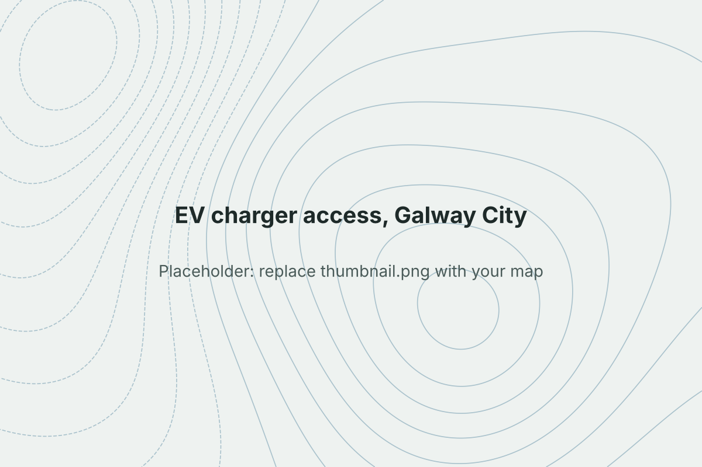

```{=html}
<dl class="project-facts">
  <dt>Question</dt><dd>Which neighbourhoods in Galway City are furthest by road from a public EV charger?</dd>
  <dt>Tools</dt><dd>QGIS</dd>
  <dt>Data</dt><dd>CSO Census Small Areas, public EV charge point locations, OpenStreetMap road network</dd>
  <dt>CRS</dt><dd>Irish Transverse Mercator (EPSG:2157)</dd>
</dl>
```

## Problem

Ireland's EV targets depend on public charging, but straight-line distance hides how far people actually have to drive. This project measures road distance from each Census Small Area to its nearest charger to find the gaps.

## Data

- CSO Census Small Area boundaries, with population
- Public EV charge point locations
- OpenStreetMap road network, clipped to Galway City

## Method

- Converted Small Area polygons to centroids
- Built a routable road network from OSM
- Calculated the shortest road distance from each centroid to its nearest charger
- Classified Small Areas into distance bands and mapped them as a choropleth

## Result

{fig-alt="Choropleth of road distance to nearest EV charger in Galway City"}

::: {.todo}
**Add:** your final map, plus 2–3 findings with numbers. For example: the share of Small Areas (or residents) more than 2 km by road from a charger, and which parts of the city are worst served.
:::

## Code

::: {.todo}
**Add:** link to the GitHub repo or QGIS model, e.g. `https://github.com/carlos6is/galway-ev-access`
:::
