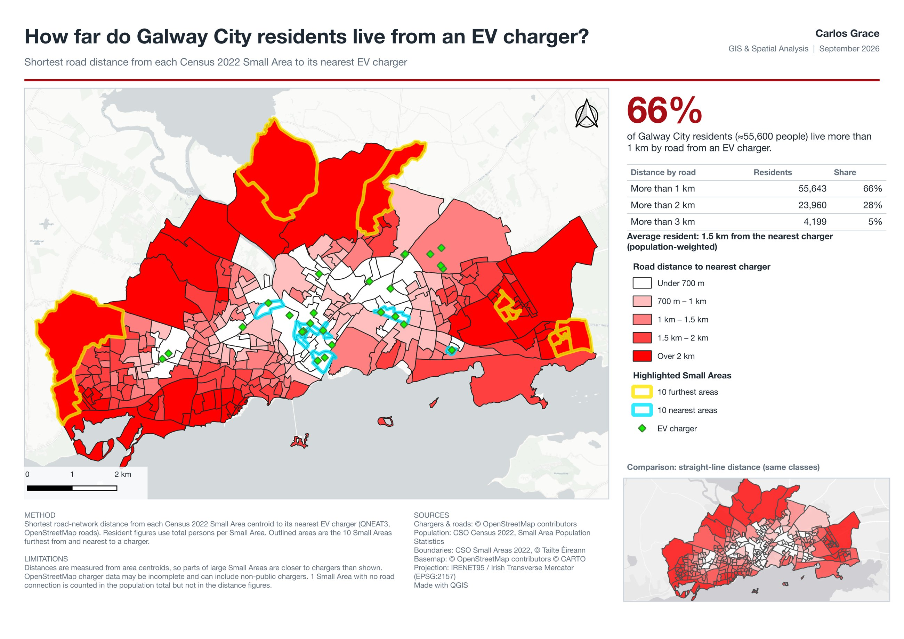

```{=html}
<dl class="project-facts">
  <dt>Question</dt><dd>How far, by road, does each Galway City resident live from an EV charger?</dd>
  <dt>Tools</dt><dd>QGIS (QuickOSM, QNEAT3), PyQGIS</dd>
  <dt>Data</dt><dd>28 EV chargers from OpenStreetMap; 309 CSO Census 2022 Small Areas with population; OpenStreetMap road network</dd>
  <dt>CRS</dt><dd>Irish Transverse Mercator (EPSG:2157)</dd>
</dl>
```

## Problem

Ireland's EV targets depend on people being able to charge, but straight-line distance hides how far people actually have to drive. This project measures road distance from every Census Small Area in Galway City to its nearest charger, then weights the result by population to show how many residents are poorly served.

## Data

- 28 EV charger locations from OpenStreetMap, downloaded with QuickOSM
- 309 CSO Census 2022 Small Area boundaries, joined to Small Area Population Statistics
- OpenStreetMap road network for Galway City

## Method

- Reprojected every layer to Irish Transverse Mercator so all distances are in metres
- Created a centroid for each Small Area
- Measured straight-line distance to the nearest charger (Distance to Nearest Hub)
- Measured road-network distance with a QNEAT3 origin–destination matrix, keeping the shortest route for each Small Area
- Joined Census population to turn distances into numbers of residents
- Built the A4 layout with a PyQGIS script, so the headline figures are calculated from the data rather than typed in

## Result

{fig-alt="Choropleth map of Galway City showing road distance from each Census Small Area to its nearest EV charger"}

- **66% of residents** (about 55,600 people) live more than 1 km by road from a charger.
- **28%** (23,960 people) live more than 2 km away, and **5%** (4,199 people) more than 3 km.
- **1.5 km** is the average resident's distance to the nearest charger, weighted by population.
- **Chargers cluster in the city centre**, so the outer residential edges of the city are the worst served.
- **Straight-line distance understates real trips**, most of all where the river or the bay forces a detour.

## Limitations

- Distances are measured from Small Area centroids, so parts of large Small Areas are closer to a charger than shown.
- OpenStreetMap charger data may be incomplete and can include chargers that aren't open to the public.
- One Small Area has no road connection. It is counted in the population total but not in the distance figures.
