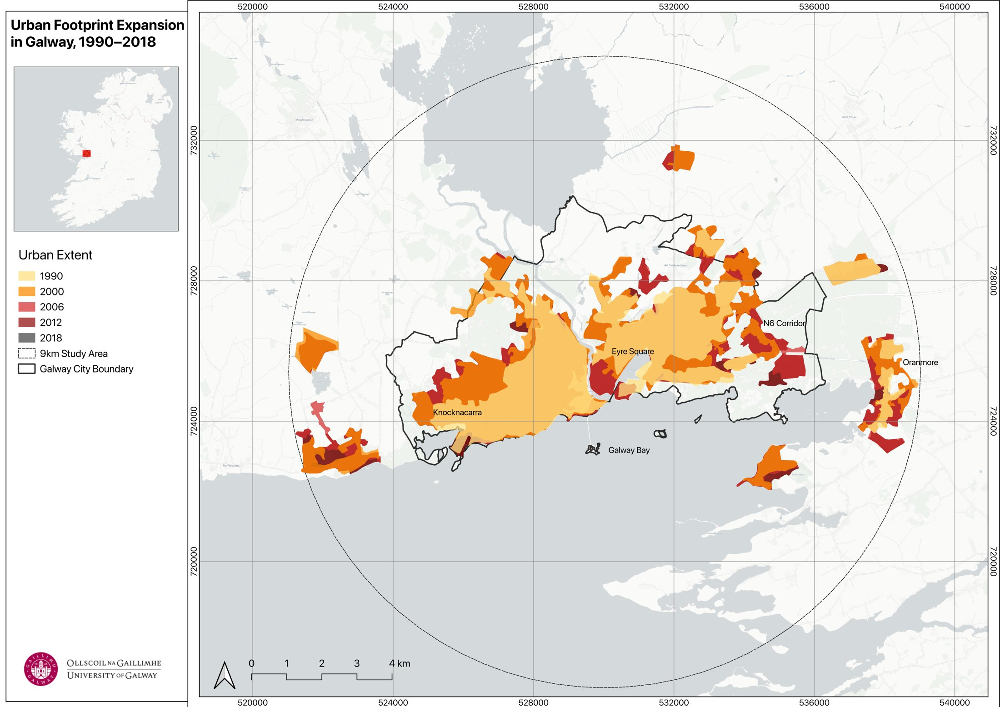
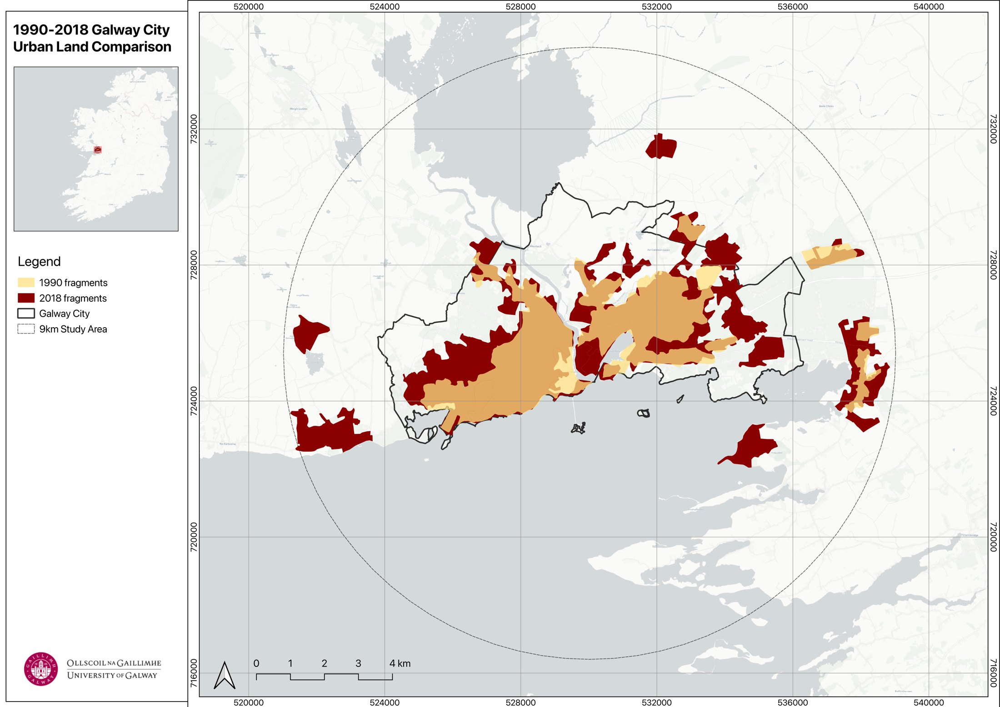
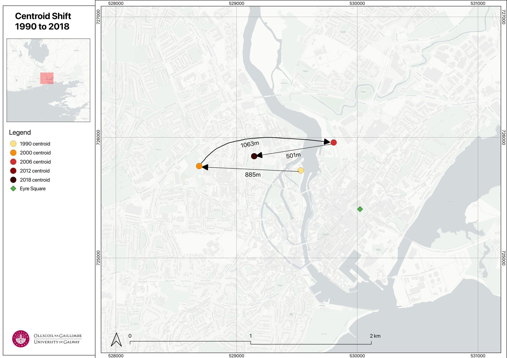

```{=html}
<dl class="project-facts">
  <dt>Question</dt><dd>How far and in which direction has Galway grown since 1990, and has planning policy changed that path?</dd>
  <dt>Tools</dt><dd>QGIS, R</dd>
  <dt>Data</dt><dd>CORINE Land Cover (1990, 2000, 2006, 2012, 2018); four Galway City Development Plans (2005–2029)</dd>
  <dt>Study area</dt><dd>9 km buffer centred on Eyre Square</dd>
  <dt>CRS</dt><dd>Irish Transverse Mercator (EPSG:2157)</dd>
  <dt>Context</dt><dd>BSc dissertation, University of Galway. Graded 78%.</dd>
</dl>
```

## Problem

Galway City nearly doubled its urban footprint during the Celtic Tiger years. Each City Development Plan since has promised compact growth, brownfield regeneration and a shift away from car dependency. This project tests whether the city has actually changed course, or whether new sustainability language has been layered on top of the suburban pattern set in the 1990s.

## Data

- CORINE Land Cover rasters at five time points, reclassified to urban and non-urban land
- Four consecutive Galway City Development Plans, 2005–2011 to 2023–2029

## Method

- Clipped each CORINE year to a 9 km buffer around Eyre Square and processed it in QGIS
- Measured four things for each year: total urban land, density across concentric rings, fragmentation (patch count and Largest Patch Index) and the area-weighted centroid of urban land
- Coded each development plan against ten codes, five path dependency indicators and five transition signals, in two passes for consistency
- Compared what the plans promised with what the land cover record shows

## Result

{fig-alt="Map of Galway's urban footprint coloured by year it first appears, 1990 to 2018, within a 9 km study area"}

- **88% growth.** The urban footprint grew by 88% between 1990 and 2018, and virtually all of it happened before 2006.
- **Fragmented growth.** Fragmentation peaked in 2006 at 32 separate urban patches, with the largest single patch only 29.5% of urban land.
- **No reversal.** After the 2008 crash, growth stopped, but the dispersed pattern it left behind did not reverse.

{fig-alt="Map comparing Galway urban land in 1990 and 2018"}

{fig-alt="Map of the urban centroid moving 885 m west, 1,063 m east, then 501 m west between 1990 and 2012"}

- **The centre of growth moved.** It shifted 885 m west during the 1990s as suburbs spread towards Knocknacarra. It then swung 1,063 m east by 2006 and 501 m back west by 2012, where it stayed.

## Policy findings

- **45 coded entries** across the four plans: 17 path dependency indicators and 28 transition signals.
- **More sustainability language.** The ratio of path dependency to transition signals fell from 1.20 in the 2005–2011 plan to 0.30 in the 2023–2029 plan.
- **Same unfinished projects.** The ring road, Ardaun new town and Ceannt Quarter regeneration appear in all four plans without being delivered.
- **Little new governance.** Only one entry across all four plans coded as innovative governance.

## Conclusion

Galway's planning shows **layering** rather than real transition. Sustainability commitments have grown more ambitious with each plan, but the car-dependent suburban form built in the 1990s is still in place. The 2023–2029 plan, backed by national mandates, gives some grounds for a new path, but the lack of new delivery mechanisms suggests the pattern has not yet broken.
