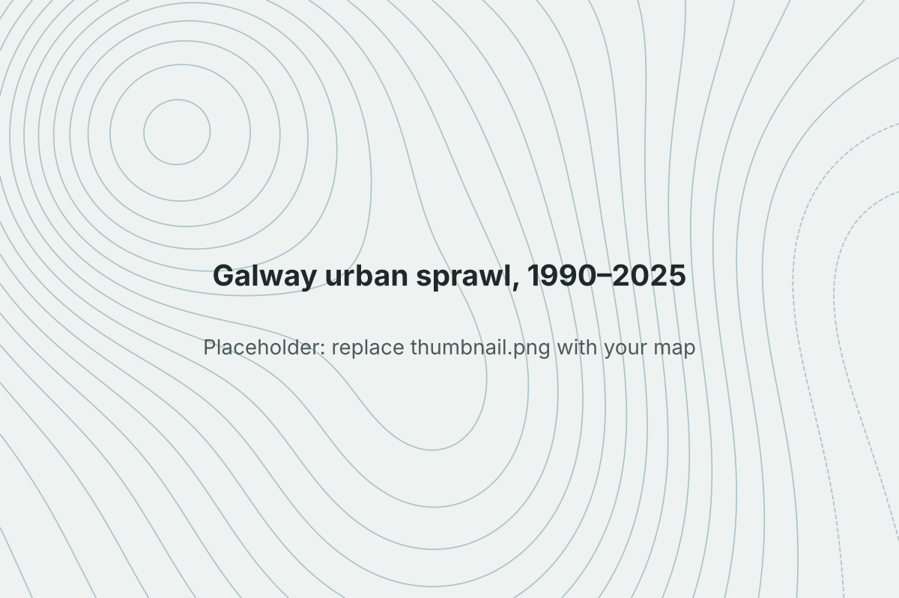

```{=html}
<dl class="project-facts">
  <dt>Question</dt><dd>How far and in which direction has Galway's built-up area spread since 1990, and how did planning policy shape it?</dd>
  <dt>Tools</dt><dd>QGIS, R</dd>
  <dt>Data</dt><dd>CORINE Land Cover (1990–2018 series and latest release), Galway City Development Plans</dd>
  <dt>CRS</dt><dd>Irish Transverse Mercator (EPSG:2157)</dd>
  <dt>Context</dt><dd>BSc dissertation, University of Galway. Graded 78%.</dd>
</dl>
```

## Problem

Galway is one of the fastest-growing cities in Ireland. This project measured where that growth went between 1990 and 2025, and whether development followed the city plans or locked in a low-density pattern that later plans struggled to reverse (path dependency).

## Data

- CORINE Land Cover layers for each available year, reclassified to artificial surfaces vs. other cover
- Galway City Development Plans, coded qualitatively for policy on density and expansion

## Method

- Reprojected all layers to ITM (EPSG:2157) so distances and areas are in metres
- Calculated artificial-surface area per year and the change between periods
- Built density gradients: share of built-up land in rings at set distances from the city centre
- Tracked the centroid of built-up land each year to measure the direction and distance of shift
- Coded development plan text for themes such as compact growth and suburban expansion, then compared policy timing with the spatial change

## Result

{fig-alt="Map of Galway built-up area change 1990 to 2025"}

::: {.todo}
**Add:** your final change map in place of the placeholder above, plus 2–3 findings with numbers. For example: total growth in artificial surface (hectares or %), how far the centroid moved and in which direction, and which plan period lines up with the biggest change.
:::

## Code

::: {.todo}
**Add:** link to the GitHub repo with the R scripts, e.g. `https://github.com/YOUR-GITHUB-USERNAME/galway-urban-sprawl`
:::
