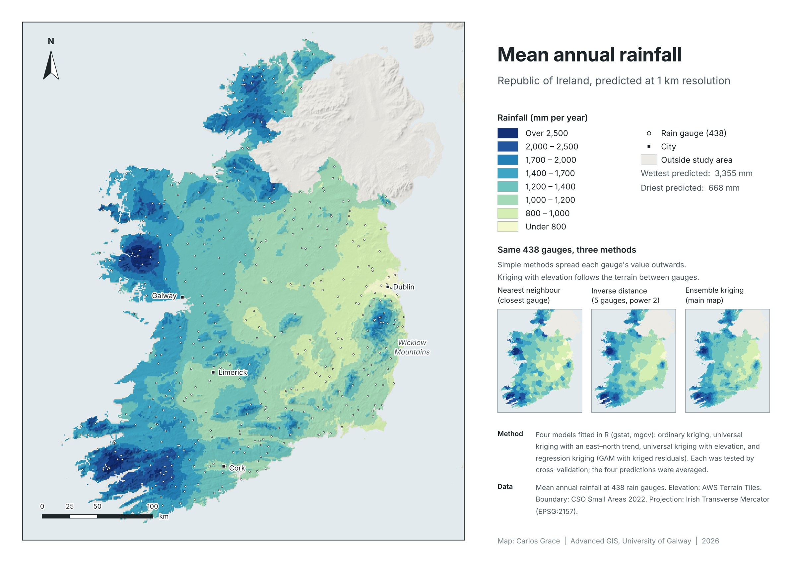

```{=html}
<dl class="project-facts">
  <dt>Question</dt><dd>How can scattered rain gauge readings be turned into a reliable rainfall map, and which kriging method predicts best?</dd>
  <dt>Tools</dt><dd>R (sf, gstat, terra, mgcv, elevatr), QGIS</dd>
  <dt>Data</dt><dd>Mean annual rainfall at 438 rain gauges; CSO 2022 Small Area boundaries; elevation model from elevatr</dd>
  <dt>CRS</dt><dd>Irish Transverse Mercator (EPSG:2157)</dd>
  <dt>Context</dt><dd>Advanced GIS module, University of Galway</dd>
</dl>
```

## Problem

Rainfall is measured at a limited number of rain gauges, but planning, flood risk and environmental work need values everywhere. Kriging predicts values between stations from how similar nearby readings are, and different versions of it handle trends and terrain differently. This project tests four versions against each other and combines them.

## Data

- Mean annual rainfall at 438 rain gauges, with station height, reprojected to Irish Transverse Mercator
- CSO 2022 Small Area boundaries, merged into a single outline of the Republic of Ireland
- A digital elevation model downloaded with elevatr, used as a predictor

## Method

- Built a 1 km prediction grid over the Republic of Ireland
- **Ordinary kriging** with a spherical variogram fitted to the station data
- **Universal kriging** with an east–north trend, because rainfall falls steadily towards the east and, to a lesser extent, the north
- **Universal kriging with elevation** added to the trend, because rainfall rises with altitude
- **Regression kriging:** a generalised additive model (GAM) of easting, northing and elevation, with its residuals kriged and added back
- Tested every model with cross-validation (100-fold, and leave-one-out for regression kriging) and compared the RMSE
- Averaged the four predictions into an ensemble, which had the lowest cross-validation error of all the approaches, and mapped it in QGIS

## Result

{fig-alt="Map layout of predicted mean annual rainfall in the Republic of Ireland, from 668 mm in the east to 3,355 mm in the western mountains, with three small comparison maps"}

- **Predicted rainfall ranges from 668 mm to 3,355 mm a year.**
- **The wettest areas are the mountains of west Mayo and Kerry**, with a smaller peak over the Wicklow Mountains.
- **The east and midlands are driest**, matching the east–west trend the universal kriging picked up.
- **Elevation explains most of the local detail.** Once east, north and elevation were in the model, the trend accounted for most of the variation, and kriging the residuals added fine-scale correction.
- **Averaging beat every single model.** The ensemble of all four had the lowest cross-validation error.
- **Kriging with elevation follows the terrain.** Nearest neighbour and inverse distance weighting only spread each gauge's value outwards, so they miss rain on high ground between gauges.

## Limitations

- The grid covers the Republic of Ireland only, because the outline comes from CSO Small Areas.
- Only 23 of the 438 gauges are above 300 m, and the highest is at 701 m. Rainfall on the highest mountains is extrapolated from the elevation trend rather than measured, so the mountain peaks are the least certain part of the map.
- Rainfall is not normally distributed. Log-normal kriging would suit it better but makes back-transforming the predictions much harder.
