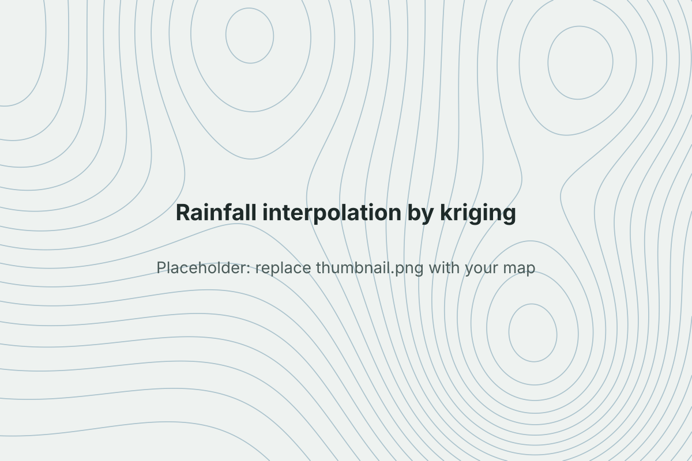

```{=html}
<dl class="project-facts">
  <dt>Question</dt><dd>How can scattered rain gauge readings be turned into a reliable rainfall map, and where is that map least certain?</dd>
  <dt>Tools</dt><dd>R</dd>
  <dt>Data</dt><dd>EDIT: rainfall station dataset and study area</dd>
  <dt>Context</dt><dd>GIS module assignment, University of Galway</dd>
</dl>
```

## Problem

Rainfall is measured at a limited number of stations, but planning and environmental work need values everywhere. Kriging predicts values between stations and, unlike simpler methods, also gives an error estimate for each location.

## Data

::: {.todo}
**Add:** the station dataset, number of stations, time period and study area.
:::

## Method

- Explored the station data and checked for trend and outliers
- Fitted an empirical variogram and a variogram model to describe how rainfall similarity changes with distance
- Ran ordinary kriging over a prediction grid
- Mapped both the predicted rainfall surface and the kriging variance
- Checked accuracy with cross-validation

## Result

{fig-alt="Kriged rainfall surface and variance map"}

::: {.todo}
**Add:** the prediction and variance maps, the fitted variogram plot, and the cross-validation error (e.g. RMSE). If your LISA analysis has the stronger visual, swap this project for that one.
:::

## Code

::: {.todo}
**Add:** link to the GitHub repo with the R script.
:::
